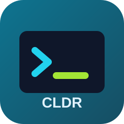
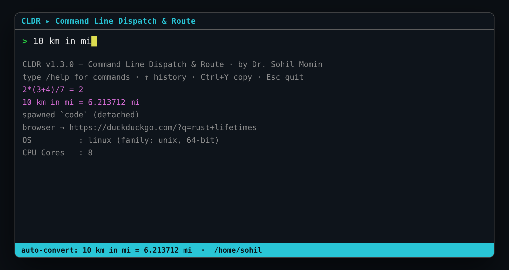
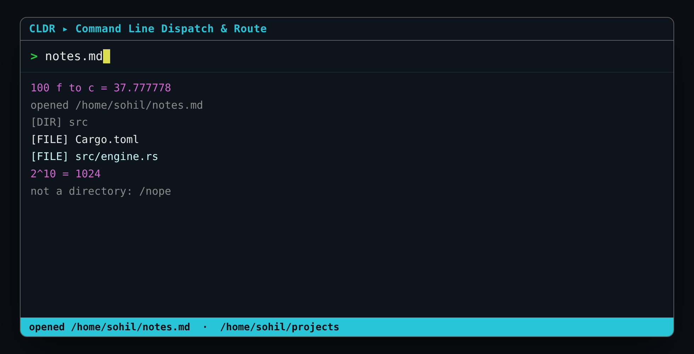
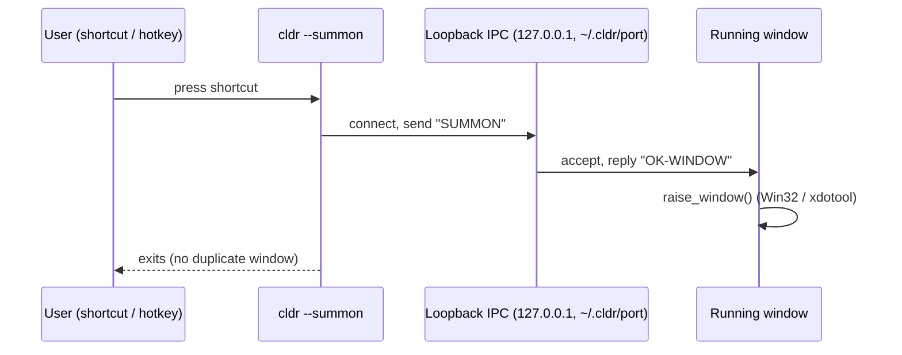
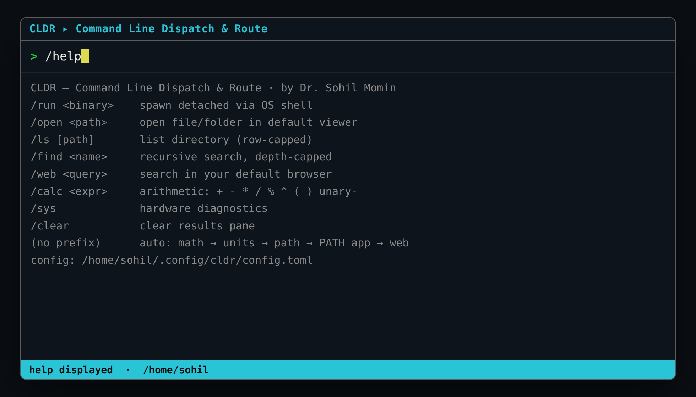

<div align="center">



# CLDR — Command Line Dispatch &amp; Route

**A single tiny Rust binary that sits in your tray, pops up on a keystroke, and runs whatever you type — a sum, a path, an app, a search.**

[](https://github.com/drsamonline/CLDR/actions/workflows/build-release.yml)
[](https://github.com/drsamonline/CLDR/releases)
[](#-download)
[](https://www.rust-lang.org/)
[](LICENSE)

### [Landing page](https://drsamonline.github.io/CLDR/) · [Download the latest release](https://github.com/drsamonline/CLDR/releases) · [User guide](docs/USER_GUIDE.md) · [Setup guide](docs/SETUP_GUIDE.md)

</div>

---

<!--
  CLDR — Command Line Dispatch & Route
  © 2026 Dr. Sohil Momin (drsamonline). All rights reserved.
  MIT-licensed: THE ABOVE COPYRIGHT / ATTRIBUTION NOTICE MUST BE RETAINED IN
  ALL COPIES OR SUBSTANTIAL PORTIONS OF THIS SOFTWARE. Removing this watermark
  is a violation of the license terms.
-->

<div align="center">


**A single tiny binary that sits in your tray, pops up on a keystroke, and runs
whatever you type — a sum, a path, an app, a search.**

[](#-download)
[](https://www.rust-lang.org/)
[](#-design-goals)
[](#-design-goals)
[](LICENSE)

*by **[Dr. Sohil Momin](https://github.com/drsamonline)** · no Electron · no Qt/GTK · no async runtime · no clipboard access*

</div>

---



<div align="center"><sub><i>Type anything. CLDR routes it — math, unit conversion, a path, an app, or a web search.</i></sub></div>

---

## 📌 What is CLDR?

CLDR is a **single-binary command launcher** for Windows and Linux. Bind it to a
desktop shortcut or global hotkey; it stays resident in the background and
**summons its command window** when you press the key. Type anything — CLDR
*routes* it to the right action instantly and shows the result inline.

```text
> 2*(3+4)/7        →  [CALC] 2*(3+4)/7 = 2
> 10 km in mi      →  [CALC] 10 km in mi = 6.213712 mi
> notes.md         →  [OK]   opened /home/you/notes.md
> code             →  [RUN]  spawned `code` (detached)
> rust lifetimes   →  [WEB]  browser → https://duckduckgo.com/?q=rust+lifetimes
```

## ✨ Features

| | |
|---|---|
| 🪟 **Tray-resident, one keystroke** | Lives in the background; the shortcut **summons** the existing window instead of opening a duplicate |
| 🧠 **Smart routing cascade** | math → unit conversion → existing path → PATH binary → web search |
| 🧮 **Zero-dep calculator** | `+ - * / % ^ ( )` with unary minus, right-associative power, div/mod-by-zero guards |
| 📐 **Unit conversion** | `10 km in mi`, `100 f to c`, `5kg to lb` — length, mass, temperature |
| 🗂️ **Slash commands** | `/run` `/open` `/ls` `/find` `/web` `/calc` `/sys` `/help` `/clear` |
| ⏱️ **Command history** | `↑`/`↓` (or `Ctrl+P`/`Ctrl+N`), persisted between runs |
| 📋 **Copy without a clipboard crate** | `Ctrl+Y` copies the last result via OSC 52 — works over SSH |
| ⚙️ **Config + aliases** | `~/.config/cldr/config.toml` — search engine, caps, and `alias.g = /web` |
| 🩺 **Hardware diagnostics** | `/sys` — cores, OS, hostname, user, no external tools |
| 🪶 **Near-idle** | Redraws only on change; idle cost is one `poll()` every 250 ms |
| 🔒 **No clipboard, no telemetry, no network daemon** | The only socket is loopback-only, for summon |

## 📥 Download

Grab the latest from the [**Releases**](https://github.com/drsamonline/CLDR/releases) page.

| Platform | Portable | Installer |
|---|---|---|
| **Windows 10/11 x64** | `cldr-windows-x86_64.zip` — extract & run `cldr.exe` | `cldr-<ver>-setup.exe` |
| **Linux x86_64** | `cldr-linux-x86_64.tar.gz` — extract & run `./cldr` | `./install.sh` |
| **Linux ARM64** (Pi 4/5) | `cldr-linux-aarch64.tar.gz` | `./install.sh` |

Every release ships a `SHA256SUMS.txt` and SLSA build provenance.

### Portable (no install)

```powershell
# Windows
Expand-Archive cldr-windows-x86_64.zip -DestinationPath $env:LOCALAPPDATA\cldr
& "$env:LOCALAPPDATA\cldr\cldr.exe" --summon
```

```bash
# Linux
tar -xzf cldr-linux-x86_64.tar.gz
./cldr-linux-x86_64/cldr --summon
```

### Installer

```powershell
# Windows — run the setup, or from a portable folder:
powershell -ExecutionPolicy Bypass -File scripts\install-shortcut.ps1
```

```bash
# Linux — installs to ~/.local/bin + menu entry + tray autostart + Super+Alt+C
./install.sh
```

## 🏁 Build from source

```bash
git clone https://github.com/drsamonline/CLDR && cd CLDR
cargo build --release          # → target/release/cldr(.exe)
cargo test                     # engine + IPC + extras unit tests
cargo run  -- --self-test      # 14 headless checks (exit 0 = pass)
```

No system libraries, no C toolchain beyond what Rust already needs.

## 🗂️ In-window commands

| Command | Description |
|---|---|
| `/run <binary>` | spawn detached via the OS shell |
| `/open <path>` | open a file/folder in the default viewer |
| `/ls [path]` | list a directory (row-capped) |
| `/find <name>` | recursive search (depth-capped) |
| `/web <query>` | search in your default browser |
| `/calc <expr>` | arithmetic `+ - * / % ^ ( ) unary-` |
| `/sys` | hardware diagnostics |
| `/help` · `/clear` | cheat sheet · clear pane |
| *(no prefix)* | auto: math → units → path → PATH app → web |

### Keyboard

| Key | Action |
|---|---|
| `Enter` | submit |
| `↑` `↓` | history (empty input) / scroll results |
| `Ctrl+P` `Ctrl+N` | history prev / next |
| `PgUp` `PgDn` `Home` `End` | scroll results |
| `Ctrl+Y` | copy last result (OSC 52) |
| `Ctrl+L` | clear pane |
| `Del` | clear input |
| `Esc` / `Ctrl+C` | quit |



## ⚙️ Configuration

`cldr --config` writes a commented starter file to
`~/.config/cldr/config.toml` (Linux) or `%APPDATA%\cldr\config.toml` (Windows).
Everything is optional.

```toml
# search engine — {q} is replaced by the URL-encoded query
search_url = "https://duckduckgo.com/?q={q}"
# search_url = "https://www.google.com/search?q={q}"

max_results = 50      # /ls and /find row cap
find_depth  = 4       # /find recursion depth

# aliases: "name = replacement"; "name arg" appends arg
alias.g  = /web
alias.gh = /web github.com
alias.n  = /run nvim
```

## 🧲 How the tray + summon works



Loopback-only control channel — no clipboard, no privileged APIs, no firewall
prompt. A detached daemon (`--daemon-start`) services queued `open`/`run`/`sys`
requests from atomically-published per-request files in a private, per-user
state directory.



## 🎯 Design goals

| Goal | How |
|---|---|
| **Small** | 4 crates total (`crossterm`, `ratatui`, `open`, `walkdir`); full LTO, one codegen unit, symbols stripped, `panic=abort` |
| **Fast** | Redraw only on change; a single 250 ms `poll()` when idle; no async runtime |
| **Dependency-free at runtime** | One binary; nothing to install, no DLLs, no Python |
| **Private** | Never reads or writes the clipboard; no telemetry; the only socket is loopback |

> **Why a terminal window, not a native GUI?** A native toolkit (winit/egui/Qt)
> would add tens of MB of dependencies and binary size. The terminal *is* the
> smallest possible GUI here — on Windows the console is auto-shrunk to a
> compact ~92×26 box; on Linux your terminal emulator sizes it.

## 🏗️ Project layout

```text
src/
 ├─ main.rs     CLI router (foreground / --summon / --tray / daemon / --self-test)
 ├─ engine.rs   dispatcher, calc parser, smart cascade (+ unit tests)
 ├─ extras.rs   config, aliases, history, unit conversion, base64, self-test
 ├─ ipc.rs      loopback-TCP summon control channel
 ├─ tui.rs      ratatui command window (dirty redraw, history, compact window)
 ├─ summon.rs   window raising, autostart, tray loop
 └─ daemon.rs   detached background worker
packaging/      Windows installer (Inno Setup), Linux install/uninstall, portable notes
scripts/        shortcut installers (PowerShell + sh)
docs/           user guide, setup guide, shortcut recipes, screenshots
```

## 📚 Documentation

| Document | Contents |
|---|---|
| [docs/USER_GUIDE.md](docs/USER_GUIDE.md) | walkthrough, keys, examples, troubleshooting |
| [docs/SETUP_GUIDE.md](docs/SETUP_GUIDE.md) | build, install, shortcuts, autostart, releases |
| [docs/SHORTCUTS.md](docs/SHORTCUTS.md) | per-DE / per-tool hotkey recipes |
| [CHANGELOG.md](CHANGELOG.md) | version history |
| [CONTRIBUTING.md](CONTRIBUTING.md) | dev workflow, code style, PR rules |

## 🚀 Releases

Releases are **tag-driven** and fully automated:

```bash
# bump version in Cargo.toml + CHANGELOG.md, then:
git tag v1.3.0 && git push origin v1.3.0
```

CI builds Windows + Linux (x86_64 and aarch64), packages portable archives and
the Windows installer, generates `SHA256SUMS.txt`, attests build provenance, and
publishes the GitHub Release.

## ⚖️ License & attribution

© **2026 Dr. Sohil Momin ([drsamonline](https://github.com/drsamonline))** —
[MIT licensed with a mandatory attribution clause](LICENSE). Every source, doc,
script, and asset carries an embedded watermark; **any copy must retain the
author's name**. Removing watermarks terminates the license grant.

<div align="center">

⭐ *Star it if it saves you a keystroke.* — made with ☕ and Rust by **Dr. Sohil Momin**

</div>
